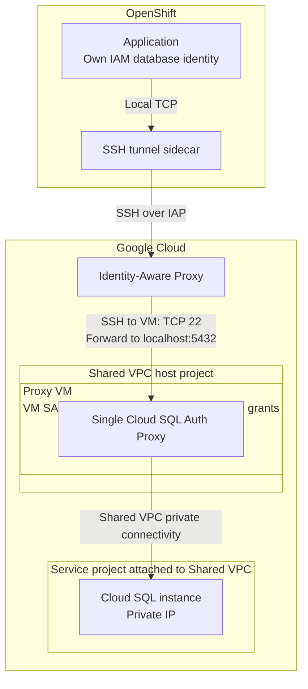

# Cloud SQL private IP tunnel for the importer

This guide describes how to configure a sample service running in OpenShift using TCP db connection:

```text
OpenShift service -> localhost:5432 -> SSH over IAP -> VM localhost:5432
  -> Cloud SQL Auth Proxy -> NameX Cloud SQL private IP
```

## Network and identity diagram



Arrows show the network path. Cloud SQL instances belong to the attached service
projects; their private IP connectivity uses the host project's Shared VPC and
private service access.

Each VM runs a single Cloud SQL Auth Proxy for one database target. Separate
targets use separate VMs and tunnels; the setup below describes one such VM.

The VM service account authorizes the proxy to establish connections, but does
not grant the application database access. In this application-managed IAM
setup, the application supplies its own IAM token and database username and
requires Cloud SQL IAM login permission and the appropriate SQL grants. The
proxy does not run with `--auto-iam-authn`.

## IAP and IAM prerequisites

Enable the Identity-Aware Proxy API in the VM project:

```bash
gcloud services enable iap.googleapis.com --project=<...>
```

Grant the OpenShift service account
`sa-solr-importer@<...>.iam.gserviceaccount.com` the following access:

| Resource | Role |
| --- | --- |
| <...> project | `roles/compute.viewer` |
| IAP tunnel for `northamerica-northeast1-a/sql-proxy-vm-...` | `roles/iap.tunnelResourceAccessor` |
| Compute instance `northamerica-northeast1-a/sql-proxy-vm-...` | `roles/compute.osLogin` |
| VM service account `sa-cloudsql-proxy-vm@<...>.iam.gserviceaccount.com` | `roles/iam.serviceAccountUser` |

## VM and proxy used in the test

To create a VM with OS Login enabled in the Shared VPC host project, use the following command. Check if the corresponding VM already exists in the Shared VPC of interest.

```bash
gcloud compute instances create sql-proxy-vm-test \
  --project=c4hnrd-test \
  --zone=northamerica-northeast1-a \
  --machine-type=e2-small \
  --network-interface=network=projects/c4hnrd-test/global/networks/bcr-vpc-test,subnet=projects/c4hnrd-test/regions/northamerica-northeast1/subnetworks/bcr-common-test-montreal,stack-type=IPV4_ONLY,no-address \
  --metadata-from-file=startup-script=script.sh \
  --service-account=sa-cloudsql-proxy-vm@c4hnrd-test.iam.gserviceaccount.com \
  --scopes=https://www.googleapis.com/auth/cloud-platform \
  --metadata=enable-oslogin=TRUE \
  --tags=sql-proxy \
  --create-disk=auto-delete=yes,boot=yes,image=projects/cos-cloud/global/images/cos-121-18867-199-38,mode=rw,size=10GB,type=pd-ssd
```

The `script.sh` supplied as startup metadata was:

```bash
#!/bin/bash
set -euo pipefail

systemctl start docker || true

docker run -d \
  --name=sql-proxy \
  --restart=always \
  -p 127.0.0.1:5432:5432 \
  gcr.io/cloud-sql-connectors/cloud-sql-proxy:2.18.3 \
  --address=0.0.0.0 \
  --port=5432 \
  --private-ip \
  a083gt-test:northamerica-northeast1:namex-db-test

sleep 5
docker logs sql-proxy
```

For a manual workstation test, forward a free local port to the proxy:

```bash
gcloud compute ssh sql-proxy-vm-test \
  --zone=northamerica-northeast1-a \
  --project=c4hnrd-test \
  --tunnel-through-iap \
  --ssh-flag="-L 5433:127.0.0.1:5432" \
  --ssh-flag="-N"
```

Where we can connect to it locally via:

```bash
LOCAL_PORT=5433
DATABASE=namex
IAM_EMAIL=$(gcloud config get-value account)
IAM_EMAIL="${IAM_EMAIL%.gserviceaccount.com}"
PGPASSWORD="$(gcloud auth print-access-token)" psql \
  -h 127.0.0.1 \
  -p "$LOCAL_PORT" \
  -U "$IAM_EMAIL" \
  -d "$DATABASE"
```

## 1. Update the importer Secret

DATABASE_TCP_IAM_AUTH variable may need to be introduced for backward compatibility.

```python
      connection_name = app.config.get("DATABASE_CONNECTION_NAME")
      db_host = app.config.get("DATABASE_HOST")
      iam_auth_value = str(app.config.get("DATABASE_TCP_IAM_AUTH", False)).strip().lower()
      if iam_auth_value not in ("true", "false"):
          raise ValueError("DATABASE_TCP_IAM_AUTH must be true or false")
      tcp_iam_auth = iam_auth_value == "true"
      if connection_name and tcp_iam_auth:
          raise ValueError("DATABASE_TCP_IAM_AUTH requires DATABASE_CONNECTION_NAME to be unset")
      if connection_name:
          db_config = DBConfig(
              instance_name=connection_name,
              database=app.config["DATABASE_NAME"],
              user=app.config["DATABASE_USERNAME"],
              ip_type="public",
              enable_iam_auth=True,
              schema=app.config.get("DATABASE_SCHEMA", ""),
          )
      elif db_host and tcp_iam_auth:
          db_config = TCPDBConfig(
              database=app.config["DATABASE_NAME"],
              user=app.config["DATABASE_USERNAME"],
              host=db_host,
              port=int(app.config.get("DATABASE_PORT", "5432")),
              enable_iam_auth=True,
              credentials_file=app.config.get(
                  "GOOGLE_APPLICATION_CREDENTIALS"
              ),
              schema=app.config.get("DATABASE_SCHEMA", ""),
          )
      elif db_host:
          db_config = TCPDBConfig(
              database=app.config["DATABASE_NAME"],
              user=app.config["DATABASE_USERNAME"],
              connect_args={"password": app.config["DATABASE_PASSWORD"]},
              host=db_host,
              port=int(app.config["DATABASE_PORT"]),
              schema=app.config.get("DATABASE_SCHEMA", ""),
          )
      else:
          raise ValueError(
              "Either DATABASE_CONNECTION_NAME (Cloud SQL Connector) or DATABASE_HOST (TCP/bastion) must be set"
          )
```

This is a fragment, not a complete Secret to apply:

```yaml
stringData:
  DATABASE_HOST: "127.0.0.1"
  DATABASE_PORT: "5432"
  DATABASE_TCP_IAM_AUTH: "True"
  DATABASE_NAME: "<existing NameX database name>"
  DATABASE_USERNAME: "sa-solr-importer@a083gt-test.iam"
```


## 2. Update the CronJob pod template

Under `spec.jobTemplate.spec.template.spec`, keep the existing
`wif-auth-fetcher` init container **first**. It writes the subject token to
`/var/run/secrets/google/token`. Add this restartable init container immediately
after it:

```yaml
initContainers:
  # Keep the existing wif-auth-fetcher entry before this entry.
  - name: ssh-tunnel
    image: gcr.io/google.com/cloudsdktool/google-cloud-cli:slim
    imagePullPolicy: IfNotPresent
    restartPolicy: Always
    resources: {}
    terminationMessagePath: /dev/termination-log
    terminationMessagePolicy: File
    env:
      - name: HOME
        value: /tmp
    command:
      - /bin/bash
      - -ec
      - |
        gcloud auth login --cred-file=/code/sa-secret/lear/wif-config.json --quiet
        exec gcloud compute ssh sql-proxy-vm-test \
          --project=c4hnrd-test \
          --zone=northamerica-northeast1-a \
          --tunnel-through-iap \
          --ssh-flag="-N" \
          --ssh-flag="-o ExitOnForwardFailure=yes" \
          --ssh-flag="-L 127.0.0.1:5432:127.0.0.1:5432" \
          --quiet
    startupProbe:
      exec:
        command:
          - /bin/bash
          - -c
          - echo > /dev/tcp/127.0.0.1/5432
      periodSeconds: 2
      timeoutSeconds: 1
      successThreshold: 1
      failureThreshold: 60
    volumeMounts:
      - name: business-sa-test-secret
        mountPath: /code/sa-secret/lear
        readOnly: true
      - name: gcp-wif-token
        mountPath: /var/run/secrets/google
        readOnly: true
```
